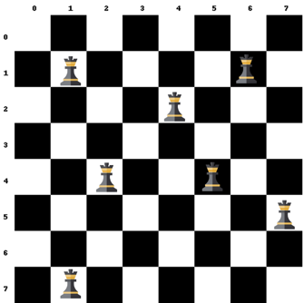
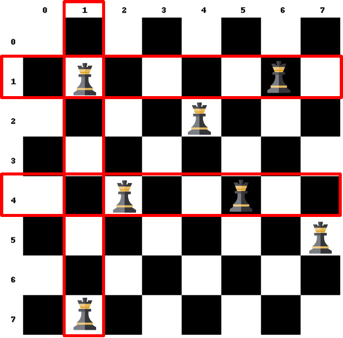
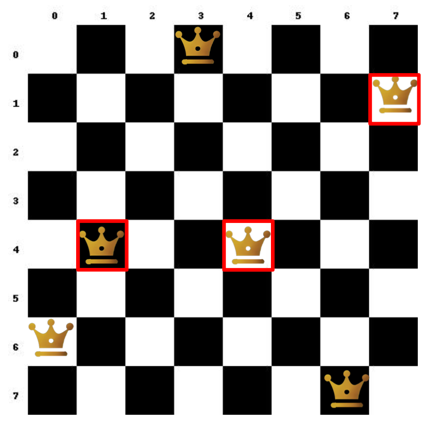

# BPALP CV06 - Hra o věže

V dnešním cvičení si procvičíme práci s dvourozměrnými poli na příkladu šachovnice. Vaším cílem bude detekovat, které věže se na šachovnici vzájemně ohrožují. Cvičení navazuje na předchozí práci s poli a rozšiřuje ji o logiku procházení matic a vyhodnocování jejich prvků.

---

## Předpoklady - práce na vlastním zařízení

_Školní zařízení již všechen potřebný software obsahují._

Pokud chcete pracovat na vlastním zařízení, postupujte podle [návodu](https://github.com/ondyChrbi/kst-bpalp-assignments-2026/blob/main/tutorials/instalace-software.md) k instalaci potřebného softwaru v souboru.

---

## Úkol 06A: Šachovnice 

- Založte nový projekt v Javě ve vývojovém prostředí NetBeans nebo jiném dle vašeho výběru.
- Realizujte algoritmus pro detekci ohrožených věží na šachovnici.
    - Šachovnici realizujte pomocí dvourozměrného pole.
    - Šachovnici před detekcí vypište.
    - Vypište čísla řádků a sloupců na kterých se věže vzájemně ohrožují.
      - Není nutné vypisovat konkrétní souřadnice.

### Vizualizace

Jednotlivé řádky šachovnice představují indexy prvního rozměru matice a sloupce představují indexy druhého rozměru matice:



Pro správnou funkčnost agolritmu je nutné si uvědomit, jak věže na šachovnici fungují. Věž může ohrozit jinou věž, pokud se nachází ve stejném řádku nebo sloupci:



_Nezapomeňte, že každý prvek dvourozměrného pole na první úrovni obsahuje další samostatné pole._

### Definice matice podle vzoru

Následující kód definice matice obsahuje hodnoty podle vzoru výše. Můžete jí použít pro ověření funkčnosti vašeho programu.

```java
int[][] sachovnice = {
    {0, 0, 0, 0, 0, 0, 0, 0},
    {0, 1, 0, 0, 0, 0, 1, 0},
    {0, 0, 0, 0, 1, 0, 0, 0},
    {0, 0, 0, 0, 0, 0, 0, 0},
    {0, 0, 1, 0, 0, 1, 0, 0},
    {0, 0, 0, 0, 0, 0, 0, 1},
    {0, 0, 0, 0, 0, 0, 0, 0},
    {0, 1, 0, 0, 0, 0, 0, 0}
};
```

### Vzorová ukázka

Toto je možný vzorový výstup programu. Váš výstup může mít jiný formát, ale musí obsahovat stejné informace.

```console-output
O O O O O O O O 
O X O O O O X O 
O O O O X O O O 
O O O O O O O O 
O O X O O X O O 
O O O O O O O X 
O O O O O O O O 
O X O O O O O O 

Veze se ohruzuji na radkach: 1 4 
Veze se ohruzuji ve sloupcich: 1 
```

## Úkol 06B: Další funkcionality  

### 1. Náhodné rozmístění věží

Upravte algoritmus tak, aby umístění věží náhodně generoval místo využívání statické definice matice.

### 2. Úvodní logo

Přidejte do konzole úvodní logo hry, které bude obsahovat název aplikace a vaše jméno. Logo můžete vygenerovat v [ASCII Art generatoru](https://patorjk.com/software/taag/#p=display&f=Graffiti&t=Hra+o+veze&x=none&v=4&h=4&w=80&we=false)

_Zkuste si sami aplikaci doplňovat o funkcionality které Vás napadnou. Pokud Vás nic nenapadá, zkuste AI prompt na konci zadání._

## Úkol 06C: Královny  

Pokud máte chuť na větší výzvu, zkuste rozšířit algoritmus tak, aby detekoval ohrožené královny místo věží. Královna se může pohybovat jak jako věž, tak i jako střelec:



---

## Studijní prompt

Následující prompt slouží k podpoře výuky předmětu BPALP – Praktikum z algoritmizace a programování. Zadání promptu vložte do jednoho z Vámi preferovaných AI nástrojů:

```llm-ai-prompt
Jsem studentem 1. ročníku oboru Informační technologie na Fakultě elektrotechniky a informatiky Univerzity Pardubice. Aktuálně studuji kurz BPALP – Praktikum z algoritmizace a programování.

Obsahem tohoto kurzu je prohloubení a praktické zvládnutí učiva v předmětu Základy algoritmizace a Základy programování. Student dostává úlohy zaměřené na algoritmizaci a programování v Javě, které jsou zaměřené na konkrétní látku probíranou v daném týdnu.

Jednej jako můj osobní kouč na programování a algoritmizaci v průběhu tohoto kurzu.

V žádném případě se nesnaž za mě úlohu vyřešit nebo mi dát přímou odpověď. Tvým úkolem je:
- Pomoci mi pochopit danou látku do hloubky.
- Vysvětlit mi jednotlivé části kódu ve srozumitelné češtině.
- Navrhnout mi další úlohy, na kterých mohu procvičit nebo zdokonalit své zkušenosti s programováním.

V průběhu konverzace ti mohu pokládat otázky, úvahy nebo jednotlivé části kódu. Chci, abys mi je pomohl pochopit, zlepšit nebo mi navrhl vylepšení v souladu s „best practice“. Pokud v kódu uvidíš chybu, zkus mě na ni navést a dát mi nápovědy.

Aktuálně se nacházíme ve 5. týdnu semestru.

Dosavadní znalosti z předchozích týdnů:
- Základní aritmetické operace, celá a desetinná čísla, výpis do konzole, proměnné.
- Uživatelský vstup, konstanty, desetinná čísla.
- Podmínky, rozhodování if-else, switch, generátor náhodných čísel.
- Cykly for, while, do-while a matematická knihovna.
- Pole (Array) v javě, indexování, procházení pomocí cyklu

Téma dnešního cvičení:
- Dvourozměrná pole

Další informace:
- Programovací jazyk: Java
- Vývojové prostředí: Apache NetBeans
- Prozatím nepoužívej OOP, vícevláknové programování, dynamické struktury nebo funkcionality z Javy 25 nebo novější.

Pro začátek mi navrhni, jak mi můžeš pomoci se zvládnutím tohoto úkolu. Pro první odpověď mi vytvoř interaktivní menu podobného formátu:

-----------------------------------------
1. 📕 Vysvětlit danou látku
2. 🧩 Navrhnout úlohu na procvičení
3. 🔎 Projít můj kód
4. [Další možnost, kterou uznáš za vhodnou]
5. [Další možnost, kterou uznáš za vhodnou]
6.❓ Cokoliv jiného, s čím ti můžu pomoci?
-----------------------------------------
```

*Jako základ pro tvorbu studijního promptu byl využit prompt z videa [Learning to code has changed - Traversy Media](https://www.youtube.com/watch?v=gQnBetuyktk).* 